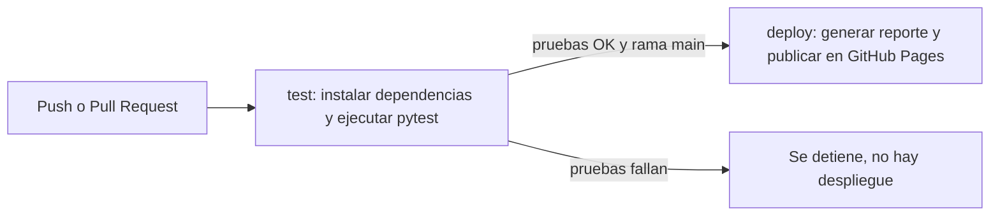

# Scraping de portátiles con CI/CD en GitHub Actions

Proyecto de la asignatura **Programación para análisis de datos** (Evidencia de aprendizaje 2).
Extrae con BeautifulSoup los portátiles del sitio de pruebas [webscraper.io](https://webscraper.io/test-sites/e-commerce/static/computers/laptops), analiza los datos y publica un reporte automáticamente mediante un pipeline de integración y despliegue continuos.

**Reporte publicado:** https://yarasanchez0708-stack.github.io/scraping-portatiles/

## Estructura del repositorio

```
├── .github/workflows/ci.yml   # pipeline CI/CD (GitHub Actions)
├── src/
│   ├── scraper_bs4.py         # extracción de datos con BeautifulSoup
│   └── generar_reporte.py     # limpieza, análisis y reporte HTML
├── tests/
│   ├── test_scraper.py        # pruebas del scraper
│   └── test_reporte.py        # pruebas del generador de reporte
├── data/                      # resultados en CSV
├── pytest.ini                 # configuración de pytest
└── requirements.txt           # dependencias
```

## Cómo ejecutarlo localmente

```bash
pip install -r requirements.txt
pytest -v                       # correr las pruebas
python src/generar_reporte.py   # genera site/index.html y data/portatiles_bs4.csv
```

## Flujo de trabajo con Git y GitHub

- La rama `main` contiene siempre la versión estable.
- Cada cambio se desarrolla en una rama propia (`develop`, `feature/add-tests`, `feature/cd-pages`, `feature/readme`).
- Los cambios llegan a `main` solo mediante **Pull Request**, con las pruebas pasando.
- Los mensajes de commit describen el cambio en forma imperativa (por ejemplo, `Add unit tests for the scraper`).

## Pipeline DevOps (GitHub Actions)

El archivo `.github/workflows/ci.yml` define dos trabajos:



1. **Integración continua (`test`)**: se ejecuta en cada push a `main` o `feature/**` y en cada Pull Request. Instala las dependencias y corre las pruebas con pytest.
2. **Despliegue continuo (`deploy`)**: solo se ejecuta si `test` pasó y el cambio llegó a `main`. Descarga los datos, genera el reporte HTML y lo publica en GitHub Pages.

### Pruebas automatizadas

Las pruebas usan HTML y datos de ejemplo, por lo que no dependen de internet. Verifican la conversión de precios y opiniones, la extracción de pulgadas y RAM, el análisis del listado de productos, la limpieza de datos y la generación del reporte.

## Resultados del análisis

Última ejecución del pipeline:

- 117 portátiles únicos analizados.
- Precio promedio: USD 909.39 (mínimo USD 295.99, máximo USD 1799.00).
- El precio promedio aumenta con la memoria RAM.

## Uso responsable

El sitio utilizado fue creado para practicar scraping. El código usa pausas entre solicitudes y fines académicos únicamente.
